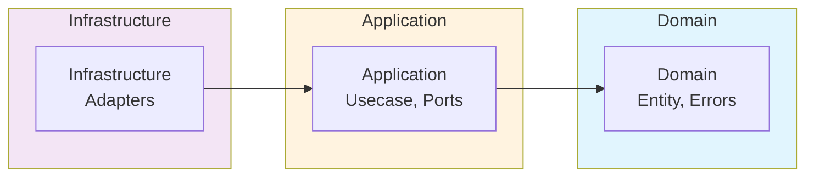

# @hexafy/core

Core hexagonal architecture primitives for TypeScript: use cases, domain building blocks, and infrastructure ports/adapters.

## Why this package exists

`@hexafy/core` is the foundation of the Hexafy package family.  
It keeps business logic framework-agnostic and provides a small, explicit API for:

- application orchestration (`Usecase`, `ServiceBase`)
- use-case outcome contract (`UsecaseResult`)
- domain errors and primitives (`ApplicationError`, `Entity`, `AggregateRoot`, `ValueObject`)
- cross-cutting ports and default adapters (logging, metrics, clock, identifier)

## Architecture overview

This package implements [hexagonal (ports-and-adapters) architecture](https://alistair.cockburn.us/hexagonal-architecture/) to keep your business logic independent of frameworks, databases, and external services.

### Dependencies flow



**Rule:** Dependencies flow inward. Infrastructure depends on Application (implements ports), Application depends on Domain (uses primitives). Domain has no dependencies.

## Installation

```bash
npm install @hexafy/core
# or
bun add @hexafy/core
# or
yarn add @hexafy/core
```

## Quick start and recommended usage

```ts
import {
  type LoggingPort,
  Usecase,
  type UsecaseConfiguration
} from '@hexafy/core/application';
import { ValidationError } from '@hexafy/core/domain';

interface CreateUserInput {
  email: string;
  name: string;
}

interface User {
  id: string;
  email: string;
  name: string;
}

class CreateUserUseCase extends Usecase<CreateUserInput, User> {
  constructor(config?: UsecaseConfiguration) {
    super(config);
  }

  protected async executeInternal(
    input: CreateUserInput,
    logger: LoggingPort
  ): Promise<User> {
    if (!input.email.includes('@')) {
      throw new ValidationError('Invalid email');
    }

    logger.info('User created', { email: input.email });
    return { id: 'user_123', email: input.email, name: input.name };
  }
}

// Usage
const useCase = new CreateUserUseCase();
const result = await useCase.execute({
  email: 'user@example.com',
  name: 'John'
});

if (result.success) {
  console.log('User:', result.value);
} else {
  console.error('Failed:', result.error);
}
```

**Best practices:**

- Keep business rules in domain/application layers; framework details in infrastructure adapters
- Use `Usecase` for operation boundaries and `ServiceBase` for reusable services
- In `executeInternal`, return plain output for success; throw typed domain errors for business failures
- Handle outcomes via `result.success` at `execute()` call sites
- Import from explicit subpaths (`@hexafy/core/application`, `/domain`, `/infrastructure`); avoid barrel re-exports

## Public API

The package exposes three subpath entry points:

- `@hexafy/core/application` - `Usecase`, `ServiceBase`, `UsecaseResult`, ports, and configuration
- `@hexafy/core/domain` - Domain primitives, errors, repository ports
- `@hexafy/core/infrastructure` - Default adapters (logging, clock, metrics, identifier)

See the [Exported artifacts and usage](#exported-artifacts-and-usage) table below for complete details.

## Exported artifacts and usage

| Export                                                                                                                                                     | Entry point       | What it is for                                                           | When to use                                        | Minimal usage                                      |
| ---------------------------------------------------------------------------------------------------------------------------------------------------------- | ----------------- | ------------------------------------------------------------------------ | -------------------------------------------------- | -------------------------------------------------- |
| `Usecase`, `UsecaseConfiguration`, `UsecaseRetryConfiguration`                                                                                             | `/application`    | Execution lifecycle, retries, timeouts, cancellation                     | One business operation with result contract        | `class X extends Usecase<I, O> { ... }`            |
| `ServiceBase`, `ServiceConfiguration`                                                                                                                      | `/application`    | Shared app logic without full use-case lifecycle                         | Reusable services used by multiple use cases       | `class PricingService extends ServiceBase { ... }` |
| `UsecaseResult`                                                                                                                                            | `/application`    | Typed success/failure result contract returned by `Usecase.execute(...)` | Handling use-case outcomes at call sites           | `const result = await usecase.execute(input)`      |
| `CancellationToken`                                                                                                                                        | `/application`    | Cooperative cancellation contract                                        | Request/job cancellation-aware operations          | Pass token to `.execute(...)`                      |
| `ClockPort`, `IdentifierPort`, `LoggingPort`, `MetricsPort`                                                                                                | `/application`    | Boundary contracts for cross-cutting concerns                            | Invert infrastructure dependencies in app layer    | Depend on interfaces, inject adapters              |
| `ApplicationError`                                                                                                                                         | `/domain`         | Base application error class                                             | Custom error hierarchies and error handling        | `class MyError extends ApplicationError { ... }`   |
| Domain error classes (`ValidationError`, `NotFoundError`, `ConflictError`, `UnauthorizedError`, `ForbiddenError`, `InvariantError`, `InfrastructureError`) | `/domain`         | Standardized, typed error model                                          | Expected business and boundary failures            | `throw new ValidationError('...')`                 |
| `isDomainError`, `getDomainErrorCode`, `DomainErrorLike`                                                                                                   | `/domain`         | Domain-error narrowing and metadata extraction                           | Adapter-level error mapping and formatting         | `if (isDomainError(err)) { ... }`                  |
| `ApplicationErrorOptions`, `ApplicationErrorDetails`                                                                                                       | `/domain`         | Error construction metadata typing                                       | Custom error subclasses and factories              | Pass options to `ApplicationError` subclass        |
| `Entity`, `AggregateRoot`, `ValueObject`, `UniqueIdentifier`, `Brand`                                                                                      | `/domain`         | DDD-oriented domain primitives and type branding                         | Rich domain model boundaries                       | Extend primitives in domain models                 |
| `RepositoryBase`, `RepositoryPort`                                                                                                                         | `/domain`         | Persistence abstraction contracts/bases                                  | Domain persistence ports and adapters              | Implement `RepositoryPort` in infrastructure       |
| `UnitOfWorkBase`                                                                                                                                           | `/domain`         | Transaction boundary abstraction                                         | Multi-step persistence transactions                | Extend in persistence adapters                     |
| `SystemClockAdapter`, `SystemIdentifierAdapter`                                                                                                            | `/infrastructure` | Default clock and id providers                                           | Production defaults without custom implementations | Inject adapter constants in config                 |
| `ConsoleLoggingAdapter`, `JSONConsoleLoggingAdapter`, `NoOpLoggingAdapter`                                                                                 | `/infrastructure` | Built-in logging adapters                                                | Console logging, JSON logging, or silent logging   | Use in `UsecaseConfiguration.logging`              |
| `NoOpMetricsAdapter`                                                                                                                                       | `/infrastructure` | No-op metrics implementation                                             | Disable metrics while keeping port contract        | Inject as default metrics adapter                  |

## How it fits in the Hexafy package family

`@hexafy/core` is the dependency root. Companion packages (for example `@hexafy/observability`, `@hexafy/nestjs`, `@hexafy/aws-lambda`, `@hexafy/object-storage`) extend behavior around these core contracts and should not duplicate them.

## License

MIT
